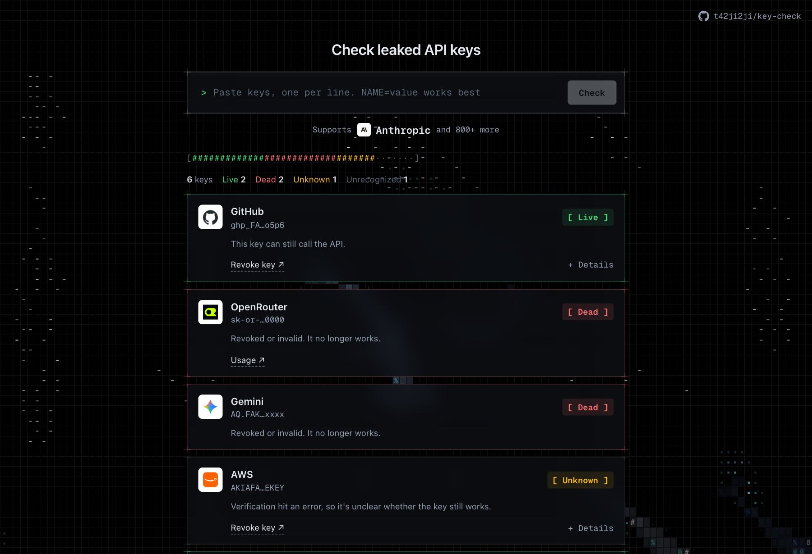

# key-check

[English](README.md) | **繁體中文**

不小心把 API key 推上 GitHub，或貼進了聊天室？把它貼進 key-check，就知道這把 key 現在還能不能用，需不需要趕快撤銷。



- 支援 GitHub、OpenAI、Anthropic、AWS、Stripe、Gemini 等 800 多種服務
- 在你自己的電腦上執行，不會保存你的 key
- 可以把整份 `.env` 一次貼進來，一次檢查全部

背後用的是開源的密鑰掃描工具 [TruffleHog](https://github.com/trufflesecurity/trufflehog)。key-check 跟 Truffle Security 沒有關係。

## 開始使用

需要先裝 [Node.js](https://nodejs.org) 18 以上。

```sh
git clone https://github.com/t42ji2ji/key-check.git
cd key-check
npm start
```

接著用瀏覽器打開 http://127.0.0.1:5199 。

第一次打開時，頁面可能會說還沒安裝 TruffleHog。按「安裝」，它會自動幫你裝好。如果你已經裝過（例如用 `brew install trufflehog`），就會直接用你的那份。

## 怎麼用

1. 貼上一把或多把 key。每一行會變成一個項目，按 × 可以刪掉。
2. 按「檢查」，或按 Enter。
3. 看每一把 key 的結果：

| 結果 | 意思 | 該做什麼 |
|---|---|---|
| **仍可使用** | 這把 key 現在還能用。 | 馬上撤銷。卡片上有連結直接帶你過去。 |
| **已失效** | 這把 key 已經不能用了。 | 不用處理，它已經被撤銷或本來就無效。 |
| **無法確認** | 檢查時出了錯。 | 晚點再試，或到該服務的後台確認。 |
| **無法辨識** | key-check 認不出這是哪種 key。 | 請自己到該服務的後台確認。 |

小技巧：連變數名稱一起貼，例如 `OPENAI_API_KEY=sk-...`，key-check 比較容易認出是哪種 key。

## 把 key 貼進來安全嗎？

- 全部在你的電腦上執行，key 不會存到硬碟，也不會寫進紀錄。
- 為了確認 key 能不能用，每把 key **只會送到它所屬的服務**：OpenAI 的 key 送到 OpenAI，GitHub 的 token 送到 GitHub，以此類推。不會送到我們或其他任何地方。
- 服務的 logo 是向 Google 抓的，所以 Google 會知道你查了哪些服務，但看不到 key。
- 請只在自己的電腦上執行，不要架到公開的伺服器讓別人貼 key。

## 常見問題

**Windows 能用嗎？**
應該可以，但目前只在 macOS 上測過。如果你在 Windows 上試了，歡迎開個 issue 告訴我們結果。

**我的 Gemini key 是 `AQ.` 開頭的，支援嗎？**
支援。TruffleHog 還認不出這種新版的 Google key，所以 key-check 會直接向 Google 確認。

**頁面把 TruffleHog 裝在哪裡？**
裝在你家目錄下的 `~/.cache/key-check/bin`，不需要管理員權限，也不會動到其他地方。想移除的話，刪掉這個資料夾就好。

## 進階

<details>
<summary>安裝的運作方式</summary>

頁面會先問本機伺服器有沒有 TruffleHog。伺服器先找 `~/.cache/key-check/bin/trufflehog`，再找 `PATH` 上的 `trufflehog`。按下「安裝」後，伺服器從 GitHub 下載官方最新版，用 release 附的 `checksums.txt` 比對 SHA-256（不符就中止），再解壓到 `~/.cache/key-check/bin`。

</details>

<details>
<summary>Gemini <code>AQ.</code> key 的細節</summary>

正式版 TruffleHog 還認不出 `AQ.` key（[#5437](https://github.com/trufflesecurity/trufflehog/issues/5437)）。[PR #5440](https://github.com/trufflesecurity/trufflehog/pull/5440) 有補上，但還沒合併。

預設情況下，TruffleHog 沒回報 Gemini key 時，伺服器會自己檢查每一個 `AQ.` 字串：用 `x-goog-api-key` header 呼叫 `generativelanguage.googleapis.com/v1beta/models`。回 200 是仍可使用，回「API key not valid」是已失效，其他都算無法確認。

你也可以自己編 PR #5440，放到 `~/.cache/key-check/bin/trufflehog`，key-check 會優先用它。不過那個 PR 只把 HTTP 400 當成無效，而無效的 `AQ.` key 回的是 401，所以要在 `pkg/detectors/googlegemini/googlegemini.go` 加上 401：

```go
case http.StatusBadRequest, http.StatusUnauthorized:
```

```sh
git clone https://github.com/trufflesecurity/trufflehog && cd trufflehog
git fetch origin pull/5440/head:pr5440 && git checkout pr5440
# 套用上面的 401 修改
go build -ldflags "-X github.com/trufflesecurity/trufflehog/v3/pkg/version.BuildVersion=pr5440" \
  -o ~/.cache/key-check/bin/trufflehog .
```

在頁面上按「安裝」會用官方版蓋掉這份自編版。

</details>

<details>
<summary>開發</summary>

- 背景是 [ascii-sharks](https://github.com/stackedlol/ascii-sharks)，原始碼在 `sharks/`，改成點擊會留下血跡、鯊魚會上浮下潛。改完用 `npm run build:sharks` 重新打包。
- 打開 http://127.0.0.1:5199/#dev 會出現「DEV fake data」按鈕：塞入假 key，並回傳各種狀態的假結果，不會呼叫 TruffleHog。程式在 `index.html` 最後的 `<!-- DEV 測試鈕 -->` 區塊。
- 介面預設英文，瀏覽器語言是中文時顯示中文。

</details>

## 授權

key-check 本身採用 MIT 授權。TruffleHog 是 AGPL-3.0，沒有包含在這個 repo 裡。

鯊魚背景（`sharks/` 和 `sharks.js`）改自 [stackedlol/ascii-sharks](https://github.com/stackedlol/ascii-sharks)。原專案沒有授權條款，所以這部分**不屬於** MIT 授權範圍，權利歸原作者所有；原作者要求的話就會移除。
